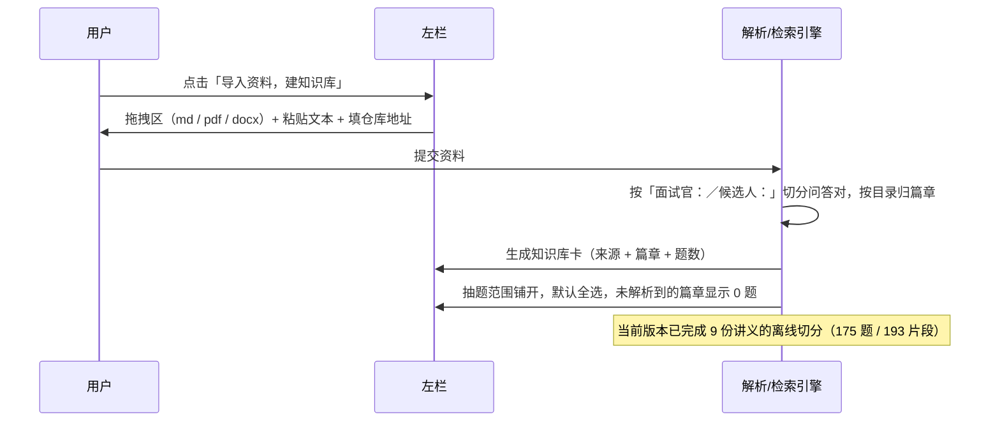
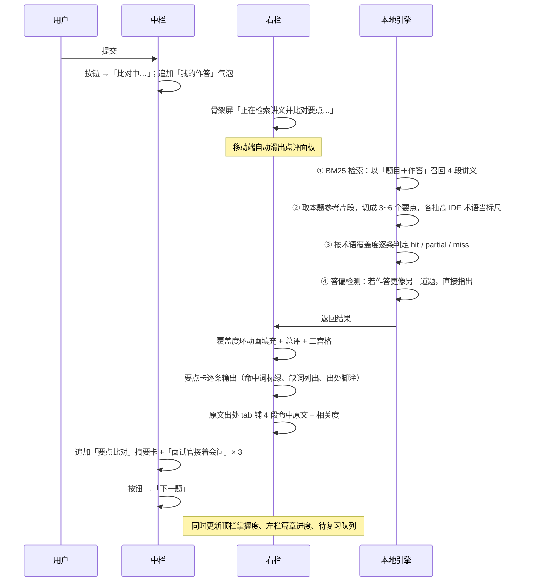

# 面试舱 Interview Drill · 知识库抽题 + AI 点评与追问 设计规范

> 版本 v3.0 ｜ 设计：UI Designer ｜ 形态：单页 Web 应用（SPA）｜ 桌面优先，移动端自适应
>
> **视觉层另见 [`design-plan.md`](./design-plan.md)（「默写纸与红笔」）。**
> 本文档负责**结构与交互**（页面骨架、组件清单、流程、响应式、无障碍、验证记录）；
> 配色 / 字体 / 版式三项以 design-plan.md 为准 —— 那份是 v4.0 的视觉主张，
> 本文第 4 节的色彩令牌已被它取代（结构令牌如间距、圆角、动效仍适用，但圆角已归零）。

---

## 0. 版本演进

| 版本 | 形态 | 变动 |
|---|---|---|
| v1.0 | 模拟面试 + 手写代码 + Code-Review 逐行批注 | 含代码编辑器、Java 语法高亮、diff 批注 |
| v2.0 | 知识库抽题刷记 | 去掉代码编辑器与 diff；改为「抽题 → 作答 → 要点覆盖度 → 待复习」 |
| **v3.0** | **接入 AI：RAG 要点覆盖 + RAG 溯源 + AI 追问** | 语料换成真实题库；点评由算法实时算出而非预置；新增原文出处与追问两个面板 |

### 本版核心：AI 以什么形态进来

不是加一个「AI 对话框」，而是让 AI 贯穿到判断、溯源、追问三个环节，并且**每一环都能说出依据**：

| 环节 | 做什么 | 依据从哪来 |
|---|---|---|
| **要点覆盖度** | 把参考答案拆成 3~6 个要点，逐条判定「已答到 / 答到一半 / 漏答」，给出得分与「还差哪些词」 | 从讲义里 BM25 检索到的本题参考片段 |
| **RAG 溯源** | 每个要点脚注出处（文件名 + 章节），可点开看本次检索命中的 4 段原文与相关度 | 真实讲义原文，不做改写 |
| **AI 追问** | ① 「面试官接着会问」直接取讲义里的下一问；② 自由追问时召回讲义原文并标注出处 | 讲义原文序列 + 检索命中片段 |

**引擎双轨**：默认跑**本地确定性引擎**（检索 / 拆要点 / 判覆盖全部在浏览器内完成，作答不上传）；开通云服务后可切到**云端大模型**，由模型生成点评措辞、记忆口诀与开放式追问，检索与出处仍走本地。顶栏有引擎状态徽标与说明浮层，两轨在界面上是同一个骨架，切换不动界面结构。

### 数据来源（真实，非编造）

题库：`github.com/whyza/itcast_interview`（黑马程序员 2023 Java 面试专题）

- 解析 9 份讲义 Markdown（准备篇的素材是简历 docx，不是问答对，故不入库），按「**面试官：**…→ 题目，**候选人：**…→ 参考答案」切分
- 产出 **175 道真题 + 193 个检索块**，覆盖 9 个篇章：Redis 28 / 数据库 22 / 框架 19 / 微服务 18 / 消息中间件 14 / 常见集合篇 19 / 并发编程 30 / JVM虚拟机 24 / 企业场景 1
- 切分脚本 `build-corpus.py` 可复跑，产出 `corpus.js`（137KB）

---

## 1. 设计上下文

| 项 | 内容 |
|---|---|
| **目标用户** | 准备 Java 后端面试的工程师，手里有现成讲义/题库，需要**反复过题加深记忆** |
| **核心任务** | 导入资料 → 选抽题范围 → 随机抽题 → 用自己的话答一遍 → 看差哪几句、出自讲义哪里 → 追问 → 进待复习 |
| **使用情境** | 桌面端为主（读题、打字、对照要点），通勤时用手机听题/口述/看点评 |
| **调性** | 工程工具感 · 精确 · 克制 · 可信赖 · **不装懂** |
| **明确回避** | 紫色渐变、霓虹发光、毛玻璃堆叠、万物皆卡片、通用 AI 审美、游戏化积分徽章 |

### 设计立意

**「说得清依据的点评」**。同类产品给的是「你答得不错，但还要注意…」这种无法执行、也无法验证的话。本产品的每一条判断都挂着证据：

- 要点覆盖度 → 标尺是该要点的高 IDF 术语，界面上把**命中的词标绿、缺的词列出来**，用户能自己复核；
- 每条要点 → 脚注讲义出处，点开就是原文；
- 追问 → 直接引用讲义原文，并注明文件、章节与相关度，不做二手转述；
- **引擎自己承认边界**：面板上明写「按术语覆盖度估算，表述差异大时可能低估」，算法算不准的地方不装作算得准。

### 视觉基调

**冷灰蓝（墨蓝 ink）+ 单一暖橙（accent）** 双色系统。冷色承担全部结构层级；暖橙只留给三件事：**覆盖度环**、**唯一的提交 CTA**、**检索相关度条**。

9 个篇章配色在色相环上均匀分布（4° Redis / 26° 并发 / 58° 准备 / 146° 框架 / 168° 集合 / 196° 数据库 / 218° 企业场景 / 248° JVM / 272° 微服务 / 340° 消息中间件），同明度带、低饱和，只出现在浅底标签与进度条上。

---

## 2. 页面结构

```
┌──────────────────────────────────────────────────────────────────────────┐
│ TOPBAR  58px                                                             │
│ [Logo] │ 9 个篇章掌握度微条 ┊ 总掌握度环 │ [引擎:本地] [待复习] [设置] [头像]│
├────────────┬──────────────────────────────────────┬──────────────────────┤
│            │  STAGE 头部 56px                     │  PANEL 头部 52px     │
│  RAIL      │  篇章标签 · 章节 · 抽题模式           │ [要点覆盖][原文出处]  │
│  280px     │  计时 ⏱ · 换一题                      │ [AI 追问]            │
│            ├──────────────────────────────────────┤                      │
│ 导入资料    │                                      │ 覆盖度环 3/3         │
│            │  对话流                               │ 等级 · 总评          │
│ 知识库卡    │   ▸ 面试官问（真题原文）              │ 用时/待补/遇见次数    │
│ （可展开）  │   ▸ 我的作答                          │ ────────────────     │
│            │   ▸ 要点比对摘要                      │ 要点清单 × N         │
│ 抽题范围    │   ▸ 面试官接着会问 × 3（点击即抽）     │  已答到/一半/漏答     │
│ 9 篇章      │                                      │  命中词 + 缺词        │
│ 勾选列表    ├──────────────────────────────────────┤  出处脚注（可点）      │
│            │  COMPOSER                            │ ────────────────     │
│            │  [文本作答]                          │ 自评 会了/还得看/不会 │
│  待复习     │  [语音][代码块][想不起来] ─ [提交]     │                      │
│  已答 1    │                                      │                      │
└────────────┴──────────────────────────────────────┴──────────────────────┘
   固定 280px          弹性（内容最大宽 820px）            固定 388px
```

### 信息层级（从强到弱）

1. **题目卡**（唯一 3px 品牌色左边框卡片 → 视线起点）
2. **要点清单**（严重度色条 + 状态徽章 + 术语 chips，反馈主体）
3. **我的作答 / 要点比对摘要**（中栏对话流）
4. **覆盖度环与统计**（右栏顶部，一眼看结论）
5. **抽题范围与篇章**（左栏，低对比，勾选态墨蓝实底）
6. **顶栏篇章微条**（密度最高、单条最小，只做趋势感知，详情放浮层）

---

## 3. 各区域组件清单

### 3.1 Topbar

| 组件 | 状态 | 说明 |
|---|---|---|
| `brand` | — | 方牌 monogram + 中文名 + `INTERVIEW DRILL` 副标 |
| `mod` × 9 | default / hover / weak(红字) | 篇章微条：篇章名 + 32×4px 进度条 + 掌握度数值；未答过的显示「—」；≥1280px 显示 7 个，≥900px 显示 4 个，<640px 整条隐藏 |
| `mastery` | 可点击 / 键盘可达 | 34px donut 环 + 总掌握度；无数据时显示「—」；点击展开全篇章浮层 |
| `engine` | local / cloud | **引擎徽标**：状态点 + 「引擎：本地 / 云端」；点击展开浮层说明两轨引擎各自做什么 |
| `icon-btn` + `badge` | default / hover | 待复习入口，badge 为 0 时整体隐藏 |
| `setPop` | closed / open | 出题顺序（随机/薄弱优先/未答过）、判定严格度、作答计时、自动下一题、深色主题、**进度存储说明 + 清空** |
| `boardPop` | closed / open | 2 列 × 9 篇章进度 + 「建议优先」标签（自动指向掌握度最低的篇章） |

### 3.2 Rail

| 组件 | 状态 | 说明 |
|---|---|---|
| `importBtn` | hover / active | 「导入资料，建知识库」墨蓝实底全宽 |
| `lib` | collapsed / expanded | 知识库卡：真实来源 URL + 库名；展开后逐条列出篇章讲义文件名与题数，并说明切分规则 |
| `chap` | default / hover / aria-pressed | 篇章行：自绘复选框 + 篇章色点 + 篇章名 + 题数 + 3px 掌握度条 + 「待N」红标 + 掌握度% |
| `scopeToggle` | — | 「全选 / 全不选」，文案随状态切换 |
| `rail__foot` | — | 「待复习 N」「已答 N」入口 → 打开抽屉 |

### 3.3 Stage

| 组件 | 说明 |
|---|---|
| `qTag` / `qSec` | 篇章标签（配色随篇章）+ 章节标签（讲义内小节） |
| `mode-seg` | 抽题模式：随机 / 待复习（≤900px 隐藏，由设置控制） |
| `timechip` | 轻量计时，**无告警态**，仅记录思考时长（≤640px 隐藏） |
| `qcard` | 题目卡：3px 品牌色左边框 +「面试官问」标签 + 真实题干（16px 加粗） |
| `.mine` | 我的作答：浅凹底气泡，保留换行 |
| `nextup` + `nq` × 3 | **面试官接着会问**：取自讲义原文序列的真题，每条标注来源理由（同一篇章的下一问 / 其他篇章的关联题），点击即抽该题 |
| `composer` | 文本作答（76–200px 自适应）+ 语音作答 + 插入代码块 + 「想不起来，看答案」+ 提交按钮（暖橙 → 比对中 → 墨蓝下一题） |

### 3.4 Panel（三个标签页）

**Tab 1 · 要点覆盖**

| 组件 | 说明 |
|---|---|
| `cov__ring` | 84px donut，0 → 实际覆盖数动画填充；环色随比例（≥80% 绿 / ≥55% 绿 / ≥30% 琥珀 / <30% 红） |
| `cov__grade` + `cov__note` | 等级徽章（掌握扎实/基本答到/还差一半/需要再过一遍）+ 由真实数据拼出的一句话总评，末尾直接点出「最该补的是：X、Y」 |
| `stat` | 三宫格：本题用时 / 待补要点 / 遇见此题次数 |
| **`point`（要点卡，核心）** | 2.5px 状态色条 + 状态徽章 + `要点 N` + 覆盖率% + **参考表述（命中术语高亮）** + `你提到` chips（绿）+ `还差` chips（灰）+ **出处脚注**（文件名 · 章节，点击跳「原文出处」）+ 漏答/半答项带「加入待复习」 |
| `point[data-state]` | `hit` 已答到（绿）/ `partial` 答到一半（琥珀）/ `miss` 漏答（红） |
| **答偏提示条** | 红底卡：检索发现作答与另一道题更匹配时触发，给出「你答的更像：X」+ 一键抽该题 |
| `seg[data-seg="self"]` | 自评三档：会了 / 还得看 / 不会 |

**Tab 2 · 原文出处（RAG 溯源）**

| 组件 | 说明 |
|---|---|
| 说明段 | 解释 RAG 机制：以「题目 + 你的作答」为查询做 BM25，相关度是相对最高分的比例 |
| `srcitem` × 4 | 检索命中卡：文件路径 · 章节 + 相关度条与数值 + 题干 + 原文（截 700 字）+ 命中术语高亮；本题对应的那片带「← 要点即由此拆出」标记 |

**Tab 3 · AI 追问**

| 组件 | 说明 |
|---|---|
| `askChain` | 「面试官接着会问」，与中栏同步 |
| `chat` / `bub` | 追问对话：我的提问（墨蓝右对齐）/ 引擎回答（浅底左对齐） |
| `cite` | 回答下方的引用块：文件 · 章节 · 相关度 + 讲义原文，明确标注「不做改写」 |
| `chatbox` + `askSend` | 追问输入框，`⌘/Ctrl+Enter` 发送 |
| `qsug` | 追问建议：由本题漏答术语自动生成（如「双向链表 是什么？」） |

### 3.5 全局

| 组件 | 说明 |
|---|---|
| `.drawer`（待复习） | 右侧 500px 抽屉：待复习卡（篇章标签 + 遇见次数 + 题干 + 要点覆盖率 + 章节 + 重新抽这题）+「开始复习这一批」批量模式；空状态有解释文案 |
| `.scrim` | 遮罩；窄屏下让出底部导航高度 |
| `.mtabs` | 移动端底部：范围 / 答题 / 点评，选中项顶部 2px 暖橙条 |
| `empty`（空状态） | 3 步引导，说明「答完提交会得到什么」 |

---

## 4. 设计令牌

```css
/* 中性阶（冷灰蓝，非纯黑纯白） */
--paper:#F4F6F8  --surface:#FFFFFF  --surface-sunken:#EFF2F5  --surface-read:#F8F9FB
--line:#E3E7EC   --line-soft:#EDF0F4  --line-strong:#CDD4DC
--ink:#161A20    --ink-2:#4A5361   --ink-3:#7E8896   --ink-4:#A5ADBA

/* 品牌墨蓝：结构、选中态、主按钮 */
--brand:#1E3A56  --brand-deep:#142B41  --brand-mid:#2F5A80  --brand-wash:#E9EFF5

/* 强调暖橙：覆盖度环 / 唯一主 CTA / 相关度条 */
--accent:#C4682F  --accent-deep:#A4521F  --accent-wash:#FBF0E7

/* 语义（要点三态 + 术语 chips 直接用这组） */
--ok:#2C8360  --warn:#B98513  --bad:#BC4038
```

| 类别 | 令牌 |
|---|---|
| 界面字体 | `IBM Plex Sans` + `IBM Plex Sans SC` —— 工程师气质无衬线，非 Inter/Roboto |
| 展示字体 | `Space Grotesk` —— Logo、覆盖度数字、题号、分组标题 |
| 等宽字体 | `JetBrains Mono` —— 计时、统计数值、术语 chips、相关度、文件路径 |
| 字号阶梯 | 10 · 10.5 · 11 · 11.5 · 12 · 12.5 · 13 · 13.5 · 14 · 15.5 · 16 · 24px |
| 间距 | 4 基准：4 / 8 / 12 / 16 / 20 / 24 / 32 / 40 / 48 |
| 圆角 | 4（标签/chips）/ 6（按钮输入）/ 9（卡片）/ 12（composer）/ 999（胶囊） |
| 阴影 | `sh-1` 静态卡片 · `sh-2` hover · `sh-3` 浮层抽屉 |
| 缓动 | `cubic-bezier(.22,1,.36,1)`；时长 140 / 240 / 420ms |
| 动效原则 | 只做状态变化动效（填充、位移、变色），无入场编排、无回弹曲线 |

---

## 5. 交互流程

### 流程 A · 建知识库



### 流程 B · 抽题

1. **选范围** — 勾选参与抽题的篇章，支持单项点击与「全选 / 全不选」；每篇章显示题数、掌握度与待复习量。
2. **选模式** — 头部切「随机 / 待复习」；或点「待复习 N」进抽屉，用「开始复习这一批」批量过题。
3. **出题** — 从真实题库随机取题，渲染题干（16px 加粗），计时从 00:00 起走。
4. **换一题** — 不计入统计。

### 流程 C · 作答

- **文字**：用自己的话答，`⌘/Ctrl + Enter` 提交。占位文案刻意写「想到几句写几句，答不全没关系」以降低门槛 —— 先回忆再对照才是记忆强化的关键。
- **语音**：录音（按钮转红），停止后转文字回填。
- **想不起来**：预填说明文字 + 该题优先进入待复习。
- **空输入保护**：不写任何内容点提交，不进入分析流程，只把占位文案换成「先写几句再提交 —— 哪怕只记得一半也算数」并聚焦。不弹窗、不报错。

### 流程 D · 提交 → 检索 → 要点比对



### 流程 E · 追问与复盘

1. **读要点** — 逐条看状态、参考表述（命中处高亮）、命中/缺失术语；点出处脚注跳到「原文出处」看讲义原文。
2. **接着答** — 点「面试官接着会问」里的任意一条，直接抽那道真题，形成真实的追问链（讲义本身就是面试官的提问序列）。
3. **自由追问** — 切到「AI 追问」，输入问题 → 引擎召回讲义原文并附出处与相关度。**检索不到就直说检索不到**，不编内容。
4. **自评 + 待复习** — 自评三档决定下次抽中概率；覆盖率 < 60% 自动进待复习，也可在要点卡上逐条「加入待复习」。
5. **下一题** — 题号推进、计时重置、右栏回空状态、顶栏与左栏数据同步更新。

---

## 6. 响应式

| 断点 | Rail | Panel | Stage | Topbar |
|---|---|---|---|---|
| **≥1440px** | 280px 常驻 | 388px 常驻 | 弹性，内容 820px 居中 | 7 个篇章微条 + 掌握度环 + 引擎徽标 |
| **1200–1439px** | 252px | 356px | 内容 760px | 隐藏微条数值 |
| **<1200px** | 抽屉（顶部按钮唤出） | 抽屉（底部 Tab 唤出） | 占满 | 底部 mtabs，workspace 让出 54px |
| **<900px** | 抽屉 | 抽屉 | 占满 | 隐藏品牌文字/掌握度文字/抽题模式/章节标签，只留 4 个微条 |
| **<640px** | 全宽抽屉 | 全宽抽屉 | 占满 | 隐藏微条与计时，工具按钮收成纯图标，浮层改全宽贴顶 |

**关键原则**

- 移动端**不隐藏任何功能** —— rail / panel 转抽屉或底部 Tab，而不是删除。
- **遮罩与抽屉都让出底部导航高度**（`bottom: calc(54px + env(safe-area-inset-bottom))`），保证抽屉打开时仍可直接点 tab 切换。
- 用 `dvh` 而非 `vh`，避免移动端地址栏收放导致的高度跳动。

---

## 7. 无障碍（WCAG 2.1 AA）

| 项 | 实现 |
|---|---|
| 对比度 | 正文 ≈ 15:1；次要文字 ≈ 7.6:1；篇章标签文字与浅底均 ≥ 4.5:1 |
| 键盘可达 | 全功能键盘可达；`:focus-visible` 统一 2px 墨蓝描边；掌握度入口 `role="button"` + `tabindex="0"` + Enter/Space；`⌘/Ctrl+Enter` 提交与追问 |
| 语义标记 | `header / main / aside / nav / article`；`role="tablist"/"tab"`、`role="switch"`、`role="list"/"listitem"` |
| 状态播报 | 覆盖度与要点结果均为静态文本可正常朗读；分析中状态文本可读 |
| 图标按钮 | 全部带 `aria-label`，装饰性 SVG `aria-hidden="true"` |
| 触摸目标 | 移动端交互元素最小 44×44px（底部 Tab 54px 高） |
| 动效 | 完整支持 `prefers-reduced-motion` |
| 打印 | 隐藏导航与输入区，保留题目与点评内容 |

---

## 8. 引擎能力与边界（诚实声明）

| 能做的 | 做不到的 / 取巧的地方 |
|---|---|
| 从 175 道真题里按篇章抽题、按薄弱优先出题 | —— |
| BM25 检索讲义原文，给出相关度并溯源 | 未做语义向量检索，同义改写但用词不同的段落可能召回不到 |
| 把参考答案切成 3~6 个要点 | 讲义是口语化逐字稿，要点边界由标点与「第一/第二」结构推断，个别句子可能切得不够干净 |
| 按术语覆盖度判定每条要点 | **这是关键词覆盖，不是语义理解**：完全讲对了但用词差异大的回答会被低估，面板上已明写此限制 |
| 术语标尺用 n-gram + 跨文档复现度自动抽取 | 少数抽出的「术语」是跨词边界的窗口串（如「节点是一」），会让分母偏大、评分偏保守 |
| 答偏检测：指出作答其实更像另一道题 | 阈值是经验值，短回答（<24 字）不做判断 |
| 追问时引用讲义原文并标出处 | 本地引擎不做生成式改写；需要模型措辞时切云端大模型 |

---

## 9. 交付清单与验证记录

| 文件 | 说明 |
|---|---|
| `index.html` | 应用主体（零构建单页） |
| `corpus.js` | RAG 语料：175 道真题 + 193 个检索块 + 篇章元数据（137KB） |
| `engine.js` | 本地 AI 引擎：分词 / BM25 / 要点拆解 / 术语标尺 / 覆盖度评分 / 答偏检测 / 追问链 |
| `build-corpus.py` | 语料构建脚本（可从 `.corpus-raw/` 复跑） |
| `design-spec.md` | 本规范 |
| `shots/` | 真实浏览器截图（4 视口 + 点评/溯源/追问/引擎/深色/待复习） |
| `.smoke.cjs` / `.render.cjs` | jsdom 交互冒烟 + Playwright 多视口渲染验证 |

### 验证结果

**jsdom 交互冒烟**（宽屏 + 窄屏各一轮，110+ 断言）全部通过，无运行时错误。覆盖：语料加载与索引构建、9 篇章渲染、真实题目抽取、空输入拦截、提交→检索→比对→点评全链路、要点状态与 chips、**RAG 溯源 4 段命中与相关度**、**追问链 3 条 + 检索式追问带引用**、掌握度与待复习联动、抽题范围切换、三个标签页、顶栏三个浮层、移动端抽屉互斥。

**本地引擎算法分离验证**

| 输入 | 要点判定 | 总覆盖 |
|---|---|---|
| 空答 | miss × 3 | **0%** |
| 半答（只讲了一半逻辑） | miss 20% / partial 39% / hit 71% | **50%** |
| 好答（完整讲到四个理由） | hit 51% / 52% / 79% | **100%** |
| 答成另一道题 | 触发答偏检测 → 指向「线程池的核心参数有哪些？」 | —— |

**Playwright 多视口渲染**（1440 / 1280 / 1024 / 390）全部通过：无横向溢出、无运行时错误；语料在各视口均正确加载（175 题 / 193 片段 / 9 篇章）；桌面恒为三栏、窄屏恒为单栏 + 底部导航；提交后要点 3 条 + 溯源 4 段 + 追问链 3 条 + 高亮 11 处 + chips 24 个 + 掌握度更新为 100%。

### 本轮真实浏览器发现并修复的缺陷

| 缺陷 | 根因 |
|---|---|
| 长术语（3~5 字）从未被抽为标尺词 | 索引只统计了 bigram 的 DF，n-gram 的 DF 恒为 0，DF 门槛把长术语全过滤了 |
| 「B+树」这类核心术语抓不到 | 分词正则要求首字符是字母，`B+树` 被拆成 `B` 和 `树` 而丢弃 |
| 「叶子节点」被误杀 | 坏边界字符表里含「点」，导致所有以「点」结尾的正常词被剔除 |
| 判分把题干里给出的词也算答对 | 未做题干词面剔除，照题目复述即可得分 |
| 进度条 0 宽度被误报为渲染缺陷 | 掌握度为 0 时 `width:0%` 属正确表现，护栏需豁免 |

---

**UI Designer** ｜ 设计系统日期 2026-10-13 ｜ 状态：可交付开发实现
